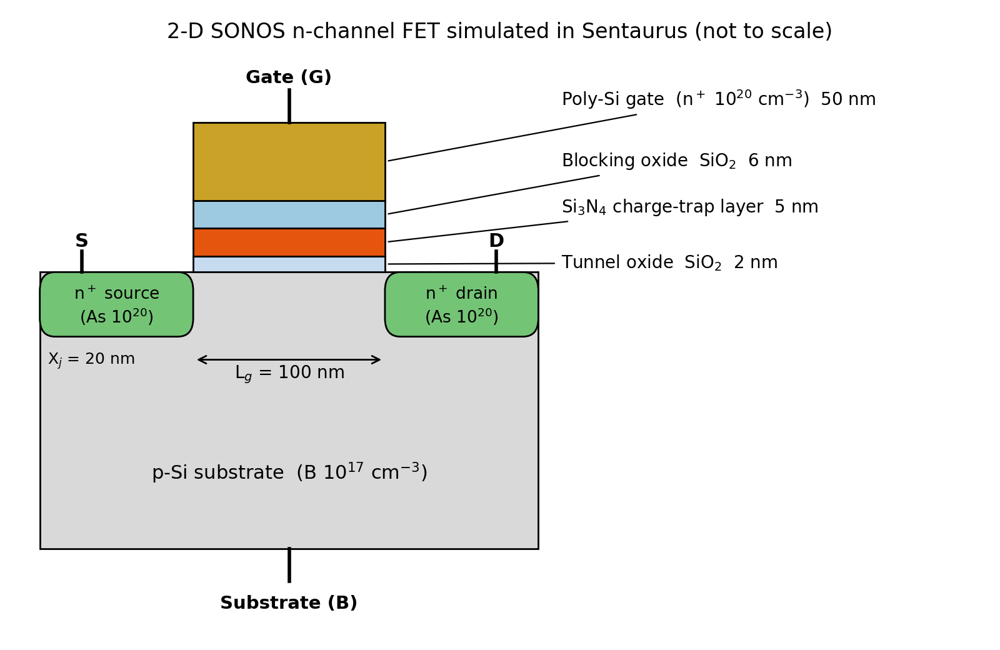
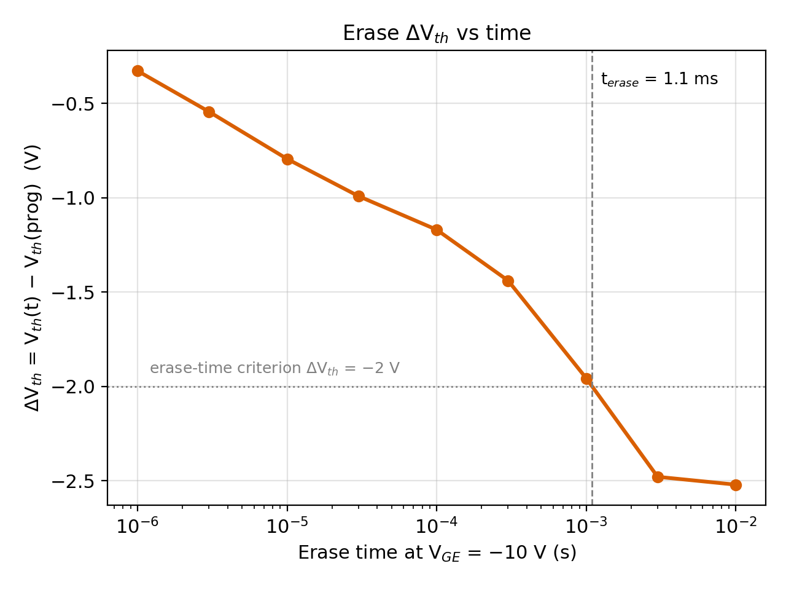
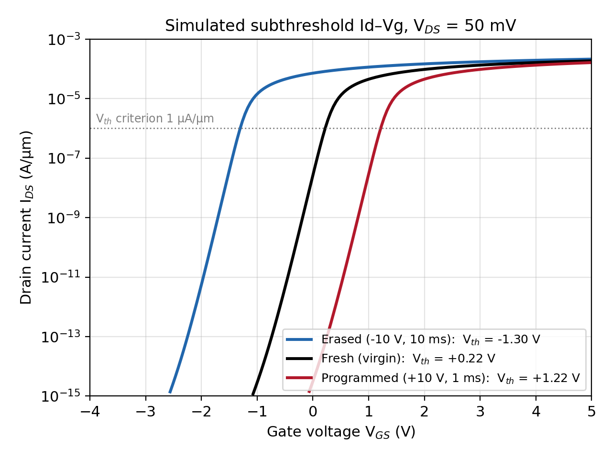
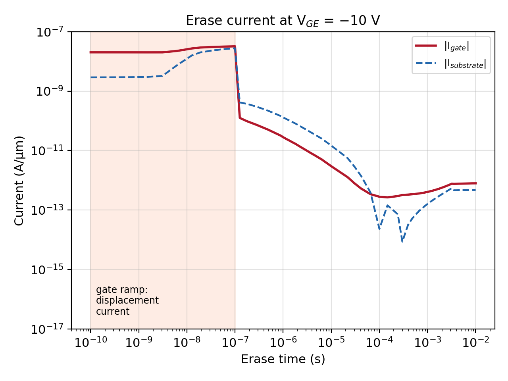
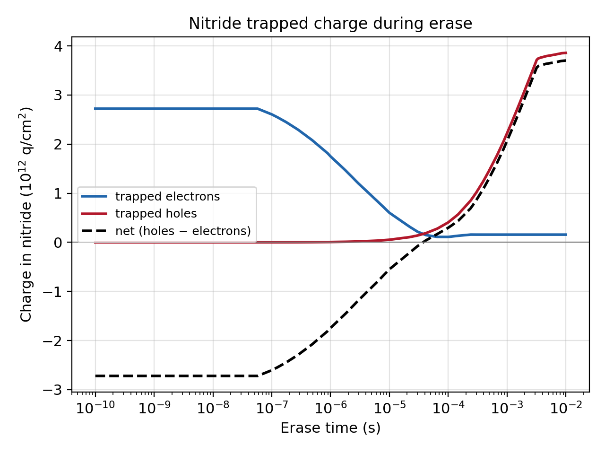
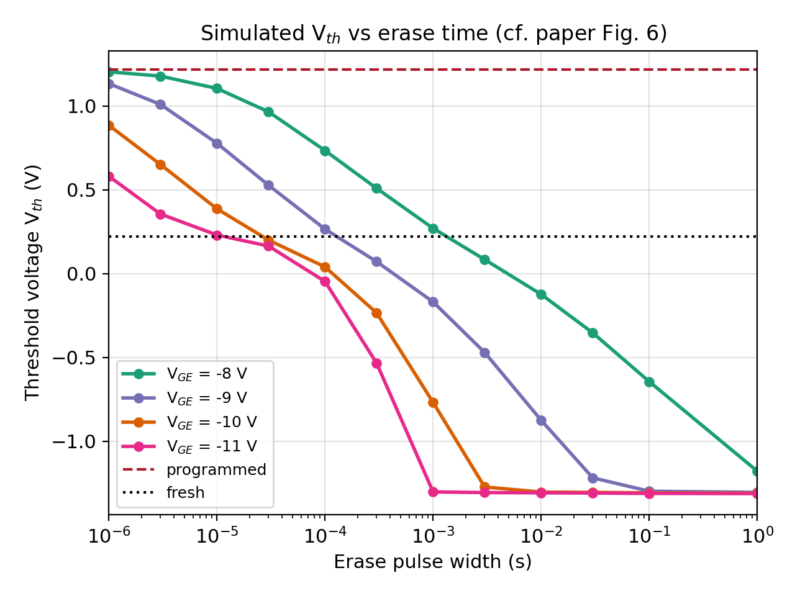
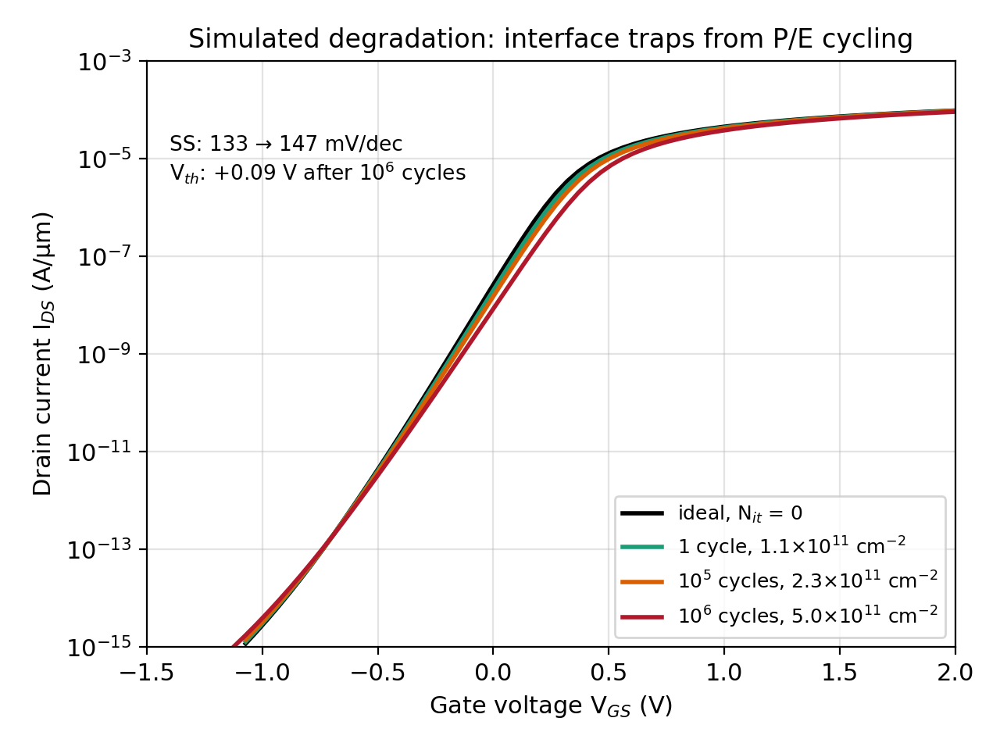
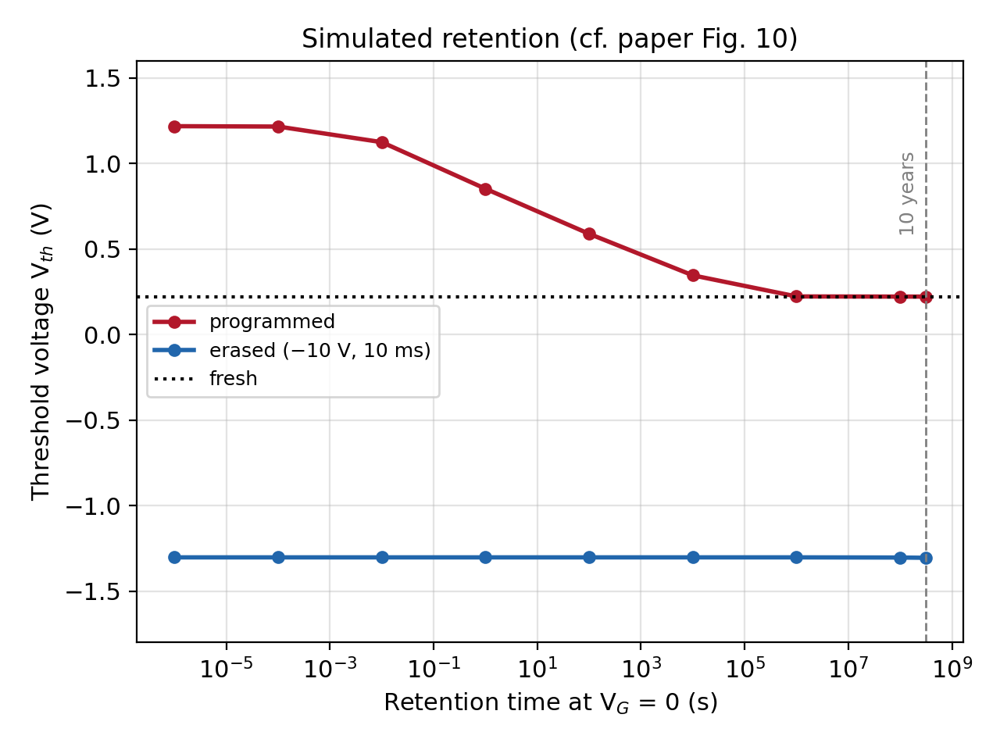

# Erase Efficiency of a SONOS Charge-Trap Memory FET

2-D TCAD simulation in **Synopsys Sentaurus** (sde, sdevice, svisual) of the erase operation of an
n-channel SONOS (poly-Si / oxide / nitride / oxide / silicon) memory transistor, checked against

> M. H. White, D. A. Adams and J. Bu, "On the go with SONOS," *IEEE Circuits & Devices Magazine*,
> vol. 16, no. 4, pp. 22–31, July 2000.

The task: extract the **erase Vth shift, erase current, erase time and residual charge**, and plot
**Id–Vg during/after erase** and **ΔVth vs. time**. Following the paper, the study was then extended with
an erase-voltage sweep (partial erase), P/E-cycling degradation, and 10-year retention.



## Device

| Layer | Material | Thickness / doping |
|---|---|---|
| Gate | n⁺ poly-Si | 50 nm, 10²⁰ cm⁻³ |
| Blocking oxide | SiO₂ | 6 nm |
| Charge-trap layer | Si₃N₄ | 5 nm |
| Tunnel oxide | SiO₂ | 2 nm |
| Substrate | p-Si | B 10¹⁷ cm⁻³ |

Nitride traps and non-local tunnelling through both oxides model electron injection (program) and
hole injection / electron de-trapping (erase). Program: +10 V for 1 ms. Erase: −10 V, states saved from 1 µs to 10 ms.

## Key results

Vth criterion: Id = 1 µA/µm at Vd = 0.05 V.

| Quantity | Value |
|---|---|
| Vth fresh / programmed / erased | 0.221 V / 1.217 V / −1.303 V |
| Erase ΔVth after 10 ms at −10 V | **−2.52 V** |
| Erase time to ΔVth = −2 V | **1.1 ms** |
| Erase gate current at 10 ms | **7.9 × 10⁻¹³ A/µm** |
| Residual net charge in nitride | **+3.7 × 10¹² q/cm²** (holes − electrons) |
| Memory window after 10 years (retention) | 1.53 V |

Erase is about **1 decade faster per volt** of more negative erase voltage (0.92 and 0.77 decades/V simulated,
~1 decade/V in the paper).

| ΔVth vs. erase time | Id–Vg: fresh, programmed, erased |
|---|---|
|  |  |
| **Erase current** | **Trapped charge during erase** |
|  |  |
| **A. Vth vs. erase time for Vge = −8 … −11 V** | **B. P/E-cycling degradation (interface traps)** |
|  |  |
| **C. Retention** | |
|  | |

Running the flow writes the full numbers to `erase_summary.txt` (base study) and
`study/study_summary.txt` (extended study).

## Folder layout

```
SONOS_Erase_Efficiency/
├── simulation_files/        Sentaurus input decks and scripts (enough to re-run everything)
│   ├── device.scm               structure + mesh (sde)
│   ├── device_fresh.scm         same device, insulating nitride (degradation reads)
│   ├── program_des.cmd          fresh state + program pulse (sdevice)
│   ├── erase_des.cmd            erase pulse, saves states 1 µs … 10 ms
│   ├── idvg_des.cmd, reads/     Id–Vg reads of every saved state
│   ├── sdevice.par              material parameters
│   ├── datexcodes.txt           nitride material definition
│   ├── plot_erase.tcl           extraction + plots for the base study (svisual)
│   ├── make_study.py, run_study.sh, plot_study.tcl   extended study
│   └── run_sonos.sh             one-shot runner for the base flow
├── figures/                 figures drawn from the simulation results
├── tools/make_figures.py    script that drew figures/ (matplotlib)
└── svisual_commands.md      commands to open the outputs in Sentaurus Visual
```

## How to reproduce

**Requirements:** Synopsys Sentaurus (sde, sdevice, svisual) version X-2025.09 or close, with a valid
license, and `python3` (standard library only, for `make_study.py`).

Copy `simulation_files/` anywhere and run everything **inside that folder**:

```bash
sde -e -l device.scm                  # -> sonos_msh.tdr  (device + mesh)
sdevice --threads 4 program_des.cmd   # -> fresh_des.sav, programmed_des.sav
sdevice --threads 4 erase_des.cmd     # -> ers_1us ... ers_10ms, erased (_des.sav)
sdevice --threads 4 idvg_des.cmd      # -> idvg_<state>_idvg_des.plt  (or run reads/*.cmd in parallel)
svisual -batchx plot_erase.tcl        # -> erase_summary.txt, erase_vth.csv, erase_transient.csv, plots
```

Steps 1–5 in one go: `./run_sonos.sh`.

Extended study (erase-voltage sweep, degradation, retention):

```bash
./run_study.sh            # generates ~120 decks with make_study.py, runs them (12 in parallel, ~1 h)
NJOBS=4 ./run_study.sh    # if you have fewer licenses
```

| Outputs | Produced by |
|---|---|
| `erase_summary.txt`, `erase_vth.csv`, `erase_transient.csv`, base plots | steps 1–5 (`program_des.cmd`, `erase_des.cmd`, `idvg_des.cmd`, `plot_erase.tcl`) |
| `study/study_summary.txt`, `study/*.csv`, `study/plots/` | `run_study.sh` (`make_study.py` writes the decks, `plot_study.tcl` the plots) |

**Notes**
- The decks use relative file names, so the files in `simulation_files/` must stay together in one folder.
- Physics / Traps / Math must be identical in all decks that `Load()` each other's `.sav` files;
  `make_study.py` copies them from `program_des.cmd` for that reason. Edit the base decks and regenerate
  with `python3 make_study.py --clean`; do not edit the generated decks.
- No Sentaurus output files (`.tdr`, `.plt`, `.sav`, extracted CSVs and plots) are stored in the repo; re-run the flow to get them.
- `tools/make_figures.py` redraws `figures/` from those outputs. It needs `numpy` and `matplotlib` and reads
  from `simulation_files/` by default (set `SONOS_SIM=/path/to/run/folder` to use another folder).
- `sdevice.par` is adapted from the Synopsys SONOS_Memory application example.
